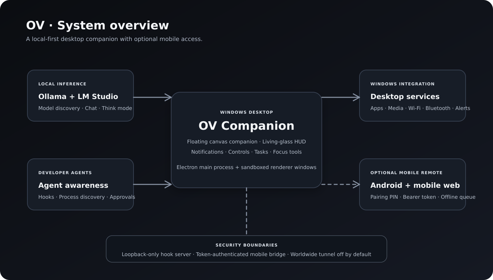
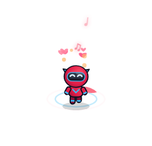
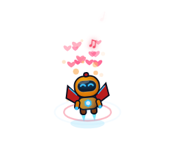
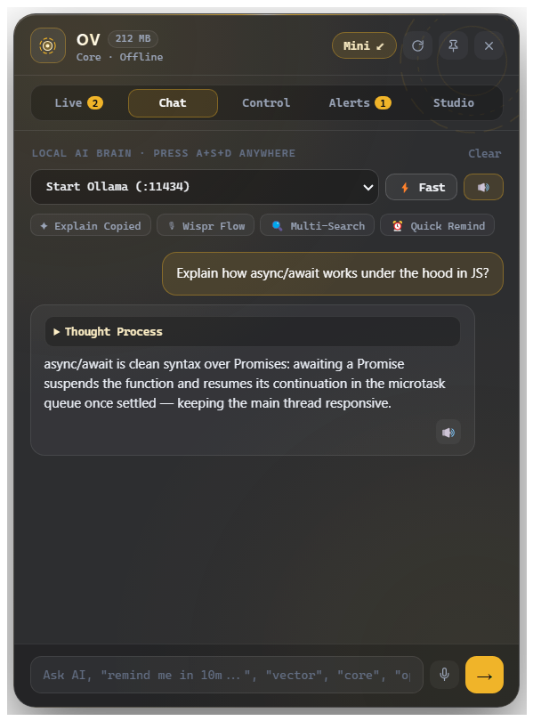
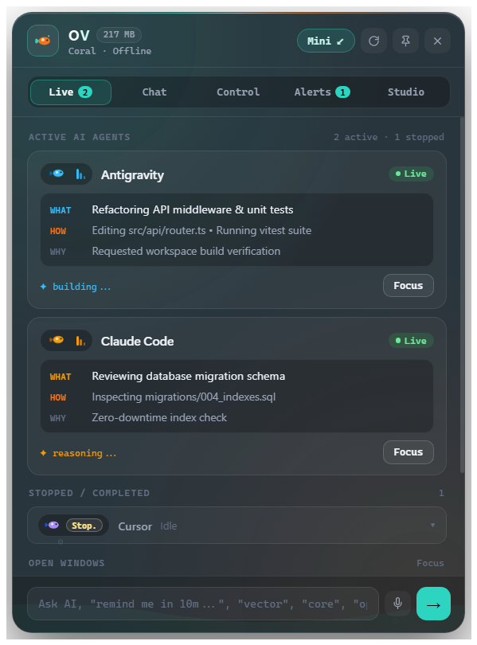

<div align="center">
  <picture>
    <source media="(prefers-color-scheme: dark)" srcset="docs/assets/ov-mark-white-transparent.png" />
    <source media="(prefers-color-scheme: light)" srcset="docs/assets/ov-mark-black-transparent.png" />
    
  </picture>
  <h1>OV — Desktop Companion</h1>
  <p><strong>A living AI companion for your desktop.</strong></p>
  <p>Local-first AI · Live coding-agent awareness · Windows productivity · Optional Android remote</p>
</div>

<p align="center">
  
</p>

> **Compatibility & Release Notice:** **OV** is the official product identity for this repository (`ov-desktop-companion`). The four built-in companions (**Vesper**, **Vector**, **Core**, and **Coral**) and their 20 skins are original procedural designs created for OV, with automatic lossless migration from legacy local settings. To preserve existing user settings, saved conversations, authentication tokens, tasks, and Claude Code hooks without data loss, internal compatibility identifiers (`%LOCALAPPDATA%\PetFish`, `petfish:*` IPC channels, and `X-PetFish-Token`) are intentionally retained until a dedicated data-migration pass. Review [`docs/PRE_RELEASE_CHECKLIST.md`](docs/PRE_RELEASE_CHECKLIST.md) before public distribution.

---

## Introduction

**OV** is a local-first AI desktop companion for Windows 10/11 built with Electron, HTML5 Canvas, Web Audio, and native Windows APIs — with **zero external runtime npm dependencies** (`~162 MB` idle RAM).

Instead of splitting your workflow across separate chat windows, notification drawers, launchers, and terminal tabs, OV places an animated, physics-driven floating character on your desktop that opens into a minimal **Living-Glass** workspace combining:

- **Local AI Intelligence** powered by your own **Ollama** or **LM Studio** models (`Fast` and `Think` reasoning modes, saved chat, structured actions, and **Focus Lens** clipboard explanation) — no cloud AI subscription required.
- **Live AI Coding-Agent Awareness** (`Claude Code` hooks, `Antigravity`, `Cursor`, `Ollama`, `LM Studio`, and other local developer tools) with real-time `WHAT / HOW / WHY` telemetry and 1-click **Allow / Deny** permission controls.
- **Daily Productivity & Native Windows Controls** (universal app/website launcher, Wi-Fi, Bluetooth, Flight Mode, audio mute, PC lock, media playback controls, smart voice reminders, tasks, focus sprint timer + XP, and a RAM-only clipboard vault).
- **Optional Android & Mobile Web Remote** featuring its own 60 FPS interactive canvas companion, PIN pairing, 256-bit Bearer authentication, offline task queue, and opt-in Cloudflare Quick Tunnel access.

---

## Feature Overview

| Capability | What OV Provides |
|---|---|
| **Floating Desktop Companion** | Always-on-top `204 × 196` transparent HTML5 Canvas character, 5 movement modes (`swim`, `fast`, `slow`, `stay`, `follow`), elastic squash-and-stretch drag physics with spring recoil, 20 skins, custom nicknames, and age-group style profiles (`0–15`, `15–30`, `30–60`). |
| **Living-Glass Interface** | Morphs smoothly between a compact **Mini Popover** (`392 × 418`) and a 5-tab **Deep Dive Studio** (`458 × 632`: `Live`, `Chat`, `Control`, `Alerts`, `Studio`) with a live `0%–100%` Solid-to-Liquid glass transparency slider. |
| **Local AI Brain** | Auto-discovers local **Ollama** (`127.0.0.1:11434`) and **LM Studio** (`127.0.0.1:1234`) models, supports `⚡ Fast` vs `🧠 Think` collapsible reasoning, persists recent chat history locally, executes safe structured actions, and explains copied code/errors via **`✦ Focus Lens`** (with indirect prompt injection blocked). |
| **Coding-Agent Awareness** | Zero-delay discovery of installed AI tools, live `WHAT / HOW / WHY` activity briefs, color-coded active badges vs `Stop.` completed indicators, Claude Code hook bridge (`PermissionRequest`, `Notification`, `Stop`), 1-click **Allow / Deny**, and configurable Auto-Pilot guardrails. |
| **Windows Controls & Launcher** | Indexes installed Windows Start Apps (`Get-StartApps`) + curated dev shells (`Terminal`, `CMD`, `PowerShell`, `VS Code`, `Brave`, `Spotify`, `Wispr Flow`) + Brave Web App mode (`--app=`); native Wi-Fi, Bluetooth, Flight Mode, Mute, Lock PC, and Windows Action Center notification reader. |
| **Voice, Music & Daily Tools** | Simultaneous **`A + S + D`** wake chord, offline Windows OneCore per-character speech synthesis, synthesized Web Audio motifs/loops, Windows SMTC Now-Playing media controls (`⏮ / ⏯ / ⏭`) + Dance Mode, smart voice reminders, two-way tasks, focus sprints + XP, RAM-only clipboard vault (16 snippets), and Windows login auto-start toggle. |
| **Android & Mobile Companion** | Self-contained mobile web UI + lightweight native Android WebView APK (`~60–85 KB` v2-signed) with floating touch-interactive canvas companion, 6-digit PIN pairing, 256-bit Bearer token, offline-queued two-way task sync, and opt-in Cloudflare Quick Tunnel. |

---

## System Architecture & Visuals

<p align="center">
  
</p>

### Original OV Companions (4 Companions · 20 Original Skins)

| Vesper — Acrobat | Vector — Aero-Mech | Core — Holographic AI | Coral — Reef |
| :---: | :---: | :---: | :---: |
|  |  |  |  |
| Pendulum tether arcs, mid-air flips, 6 skins | Jet-hover cruise, twin ion wings, 5 skins | Zero-G orbital rings, sonar pulse, 5 skins | Ribbon-fin swim, rising bubbles, 4 skins |

### Living-Glass Interface Preview (Sanitised Demo Renders)

> *Note: Screenshots below are generated automatically via `electron . --verify-render` using sanitised demo data (`Studio-5G`, `Studio Headphones`) so zero personal networks, devices, or messages appear.*

| Control Center & Music Player | Studio & Companion Customizer |
| :---: | :---: |
|  |  |

| Local AI Chat (`Think` Mode) | Live AI Coding-Agent Monitor |
| :---: | :---: |
|  |  |

### How OV Fits Together

- **Electron Main Process (`src/main/index.js`):** Owns single-instance lifecycle, 4 desktop windows (lazy-created and destroyed on close to keep idle RAM low), adaptive physics loop, tray controls, `A+S+D` chord listener, IPC handlers, and dual HTTP servers.
- **Sandboxed Preload Bridge (`src/main/preload.js`):** Exposes a narrow `window.petFishAPI` surface via `contextBridge` (`contextIsolation: true`, `nodeIntegration: false`, `sandbox: true`).
- **18 Modular Services (`src/services/`):** Dedicated Node.js modules for physics, local LLM inference, agent telemetry, hook server (`127.0.0.1:47821`), mobile bridge (`:47822`), notifications, system radios, universal app launching, music detection, reminders/tasks, RAM-only clipboard vault, and offline SVG QR generation.

See [`docs/ARCHITECTURE.md`](docs/ARCHITECTURE.md) and [`agent/ARCHITECTURE_AND_BUILD_LOG.md`](agent/ARCHITECTURE_AND_BUILD_LOG.md) for the complete module map, and [`BRAND_GUIDE.md`](BRAND_GUIDE.md) for official OV monogram usage rules.

---

## Technology Stack

- **Desktop Runtime:** Electron `^35.7.5`, Node.js (built-in `http`, `crypto`, `fs`, `child_process`, `node:sqlite`) — **0 external runtime npm dependencies**
- **Frontend & Audio:** Vanilla JavaScript, HTML5 2D Canvas, CSS3 Living-Glass Variables, Web Audio API, Windows OneCore `speechSynthesis`
- **Windows Integration:** PowerShell + WinRT (`Windows.Devices.Radios`, `GlobalSystemMediaTransportControlsSessionManager`), Win32 (`user32.dll`, `BluetoothAPIs.dll`), `netsh wlan`, Action Center SQLite snapshot
- **Local AI Providers:** Ollama (`127.0.0.1:11434`) & LM Studio (`127.0.0.1:1234`)
- **Mobile & Remote:** Vanilla HTML5/Canvas PWA (`mobile/web/index.html`), Android Java WebView (`minSdk 24`, `targetSdk 34`), Android SDK Build-Tools (`aapt2`, `d8`, `zipalign`, `apksigner`), optional `cloudflared` Quick Tunnel

---

## Installation & Quick Start

### Prerequisites

- **Windows 10 or Windows 11**
- **Node.js 20+** and **npm**
- **Optional (Local AI):** [Ollama](https://ollama.com) or [LM Studio](https://lmstudio.ai) installed locally
- **Optional (Worldwide Mobile Tunnel):** `cloudflared` on `PATH`
- **Optional (Rebuild Android APK from source):** JDK 17+ and Android SDK Platform 34 + Build-Tools 34.0.0

### Run OV on Windows

```powershell
# 1. Install development dependency (Electron)
npm install

# 2. Start OV Desktop
npm start

# 3. (Optional) Create an OV.lnk shortcut on your Windows Desktop
npm run shortcut
```

---

## Local AI Setup

1. Install and start **Ollama** (`127.0.0.1:11434`) or **LM Studio** (`127.0.0.1:1234`) on your PC.
2. Pull at least one local chat model — for fast, low-VRAM desktop responsiveness:
   ```powershell
   ollama pull qwen3.5:2b
   ```
3. Open **OV → Deep Dive → Chat** (or press **`A + S + D`** simultaneously anywhere on Windows). OV automatically discovers available local models.
4. Toggle **`⚡ Fast`** for instant replies and actions, or **`🧠 Think`** for step-by-step collapsible reasoning.

---

## Android & Mobile Companion Setup

1. **Build or install the APK** (or use any modern mobile browser):
   ```powershell
   npm run build:apk
   ```
   This compiles and v2-signs `mobile/PetFish-Mobile.apk` using a locally generated, user-locked keystore stored outside Git in `%LOCALAPPDATA%\PetFish\`.
2. On your Windows PC, open **OV → Deep Dive → Studio → Worldwide Mobile Remote**.
3. Choose **LAN Mode** (same Wi-Fi network) or click **Go Worldwide (HTTPS)** to start an opt-in temporary Cloudflare Quick Tunnel (`https://*.trycloudflare.com`).
4. Pair your phone by scanning the **offline SVG QR code**, pasting the **Pairing Link**, or entering the Server URL + **one-time 6-digit PIN** (expires in 3 minutes).
5. When your laptop is turned OFF, your mobile companion stays interactive locally and queues task edits offline — automatically syncing as soon as your laptop reconnects.
6. Click **Stop** when remote access is no longer needed, or **Rotate Key** to immediately revoke paired devices.

---

## Development & Verification

All available npm scripts in [`package.json`](package.json):

```powershell
npm start            # Launch OV Desktop via Electron
npm run verify       # Run the 8-stage security, LLM, physics, clipboard & mobile test suite
npm run shortcut     # Create Desktop OV.lnk shortcut using docs/assets/ov-icon.ico
npm run build:icon   # Regenerate fallback procedural .ico asset
npm run build:apk    # Compile & v2-sign Android APK via Android SDK build-tools
```

To run the headless Electron render check and regenerate sanitised showcase posters:

```powershell
Start-Process -FilePath ".\node_modules\electron\dist\electron.exe" -ArgumentList ". --verify-render" -PassThru -Wait
```

---

## Repository Structure

```text
src/
  main/          Electron main process (index.js) and sandboxed preload bridge (preload.js)
  renderer/      Canvas companion renderer, Living-Glass HUD, sound/TTS engine, toast, picker
  services/      18 modular services: AI brain, agent monitor, hook server, mobile bridge,
                 security, system controls, launcher, notifications, music, clipboard, QR
mobile/
  web/           Self-contained offline-first mobile web app + 60 FPS canvas companion
  android/       Hardened Android WebView wrapper + zero-Gradle PowerShell APK build script
scripts/         Automated verification suite, Claude Code hook script, shortcut creator
config/          Loopback & renderer security configuration (security.json)
docs/
  assets/        Official engraved OV logos, icon, social preview, and architecture SVG
  posters/       Sanitised UI showcase screenshots
  ARCHITECTURE.md
  PRE_RELEASE_CHECKLIST.md
security/        Internal AppSec audit scorecard, applied fixes, and fresher security guide
agent/           Persistent engineering memory, architecture log, invariants & playbook
.github/         Issue templates, PR template, and Dependabot configuration
```

---

## Security & Privacy Notes

OV interacts with sensitive local desktop data (Windows notifications, clipboard text, active windows, coding-agent transcripts, and wireless/system controls). Please review [`SECURITY.md`](SECURITY.md) before running OV on a shared or work machine:

- **Renderer Isolation & Network Block:** All Electron windows run with `contextIsolation: true`, `nodeIntegration: false`, `sandbox: true`, strict CSP, and blocked outbound renderer requests.
- **Authenticated Bridges:** Hook server binds strictly to `127.0.0.1:47821` (`X-PetFish-Token` + `Host`/`Origin` validation). Mobile server (`:47822`) is **OFF by default**, enforces 256-bit Bearer auth, 3-minute single-use PINs, 5-attempt IP lockout, and strict CORS Origin checks.
- **Indirect Prompt Injection Protection:** `✦ Focus Lens` (`explain-clipboard`) disables automatic LLM action execution (`allowActions: false`).
- **Secrets Outside Git:** Tokens, signing keys, settings, and chat history live under `%LOCALAPPDATA%\PetFish\`; Clipboard Vault is RAM-only.
- **Disclaimer:** OV has **not** undergone an independent third-party security audit, and Auto-Pilot regex rules are a convenience guardrail rather than a substitute for reviewing agent commands.

---

## Roadmap

- [x] **Original OV Companion Pack:** Four original OV-designed companions (**Vesper**, **Vector**, **Core**, **Coral**), 20 original skins, and neutral royalty-free music search links with automatic legacy settings migration.
- [ ] **Safe Data-Directory Migration:** Optional automated migration from `%LOCALAPPDATA%\PetFish` to `%LOCALAPPDATA%\OV` with zero data loss.
- [ ] **Windows Installer Packaging:** Signed Windows NSIS / MSIX installer alongside portable source execution.
- [ ] **Persistent Named Tunnels:** Optional Tailscale / Cloudflare Named Tunnel support for static mobile URLs.
- [ ] **Expanded Automated Testing:** Dedicated unit/E2E runner and GitHub Actions CI matrix.

---

## Contributing & Support

Contributions, bug reports, and documentation improvements are welcome!

- Read [`CONTRIBUTING.md`](CONTRIBUTING.md) before opening a pull request.
- Follow [`CODE_OF_CONDUCT.md`](CODE_OF_CONDUCT.md) in all project spaces.
- See [`SUPPORT.md`](SUPPORT.md) for usage help and [`SECURITY.md`](SECURITY.md) for private vulnerability disclosure.

---

## License

Code in this repository is provided under the [MIT License](LICENSE) (`Copyright (c) 2026 OV contributors` — confirm legal copyright holder name prior to public release). See [`docs/PRE_RELEASE_CHECKLIST.md`](docs/PRE_RELEASE_CHECKLIST.md) for release verification and licensing review items.
