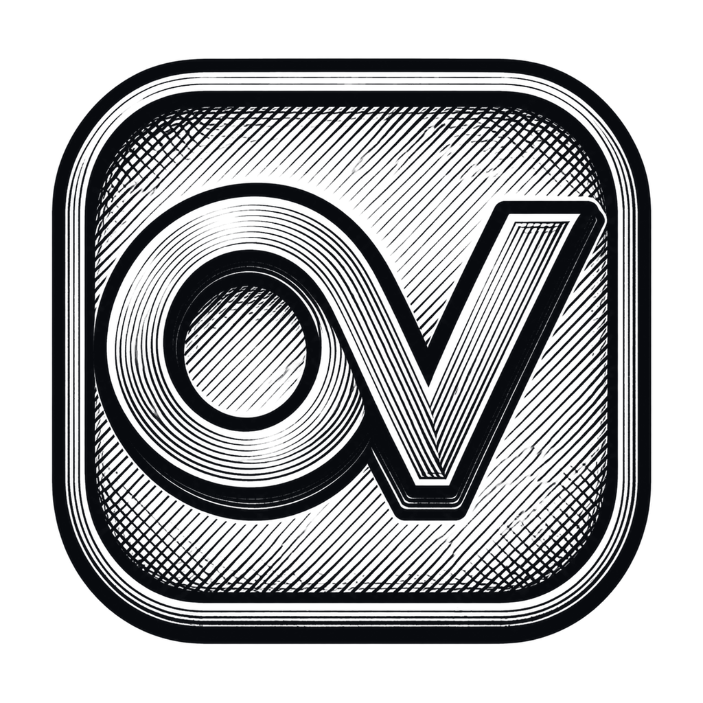
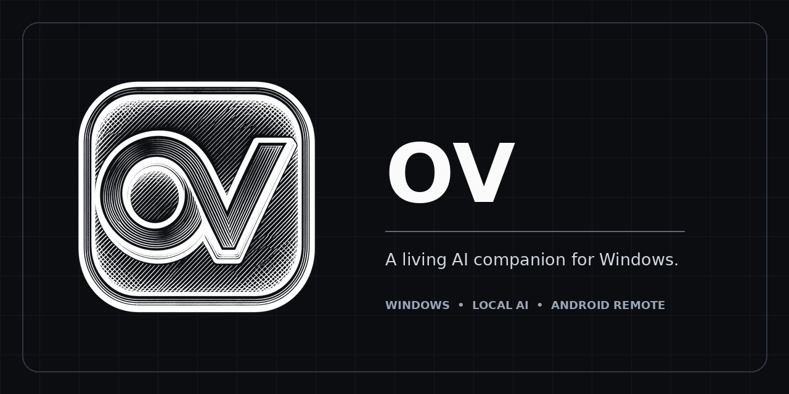
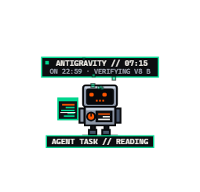
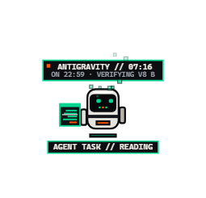
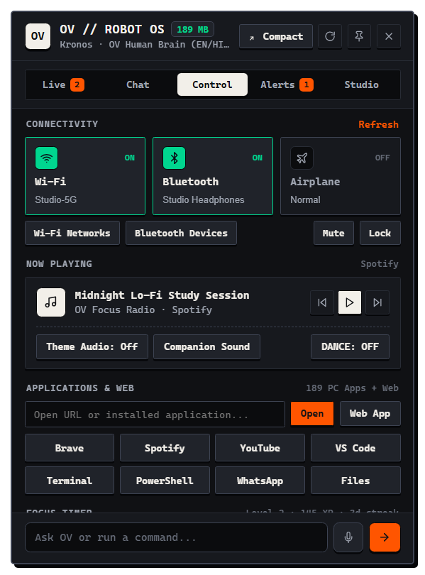
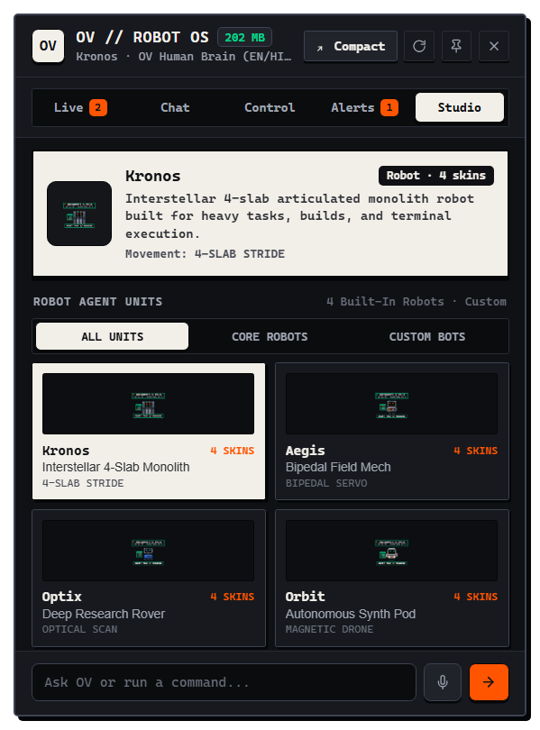

<div align="center">
  <picture>
    <source media="(prefers-color-scheme: dark)" srcset="docs/assets/ov-mark-white-transparent.png" />
    <source media="(prefers-color-scheme: light)" srcset="docs/assets/ov-mark-black-transparent.png" />
    
  </picture>
  <h1>OV v8.0 — Robot OS &amp; Local Whisper Voice Agent</h1>
  <p><strong>A local-first AI robot companion &amp; live coding-agent telemetry system for Windows.</strong></p>
  <p>4 Industrial Desktop Robots · Local Open-Source Whisper (<code>A+S+W</code>) · Live Top-of-Head Agent Timers · Single Consistent Named Neural Voices (EN / Hinglish / Hindi) · Optional Android Remote</p>
</div>

<p align="center">
  
</p>

> **Compatibility & IP Separation Notice:** **OV v8.0** (`ov-desktop-companion`) is a local-first desktop robot companion ecosystem featuring four original industrial robot units (**Kronos** — Interstellar 4-Slab Articulated Monolith, **Aegis** — Bipedal Field Mech, **Optix** — Deep Research Rover, and **Orbit** — Autonomous Synth Pod), a **Companion Studio** for custom user robots, and an **Age-Based Persona System**. This repository contains only original procedural vector/canvas hardware artwork, zero-gradient industrial UI templates, and synthesized Web Audio motifs — **zero** copyrighted third-party bitmaps, movie stills, trademarked logos, or soundtrack files are included. All user-uploaded artwork and custom robot packs remain strictly local on your device (`%LOCALAPPDATA%\PetFish\custom-heroes\`). Review [`docs/PRE_RELEASE_CHECKLIST.md`](docs/PRE_RELEASE_CHECKLIST.md) before public distribution.

---

## Introduction

**OV v8.0** is a local-first AI robot companion and live developer telemetry system for Windows 10/11 built with Electron, HTML5 Canvas, Web Audio, local open-source **Whisper (`faster-whisper`)**, and native Windows APIs — with **zero external runtime npm dependencies** (`~162 MB` idle RAM).

Instead of splitting your workflow across separate chat windows, notification drawers, media players, and terminal tabs, OV places an animated, physics-driven industrial robot on your desktop that opens into a crisp **Zero-Gradient Hardware & Archival Paper** workspace combining:

- **Local Open-Source Whisper Voice Assistant (`A + S + W` Hotkey):** Hold **`A + S + W`** together anywhere on Windows (or click **`WHISPER MIC`**) to speak commands directly to your robot using your local **`faster-whisper`** model (`"Open Spotify"`, `"Play or pause the music"`, `"Add a task to finish system design"`, `"Start a 25 minute timer"`).
- **Works Out-of-the-Box With OR Without a Local LLM Connected:**
  - **Without Ollama (Zero-Setup Offline Mode):** The **Local Whisper Voice Agent (`A+S+W`)** and **Built-In Trilingual Task & Conversational Brain** run out of the box to execute laptop commands, control music, launch apps/websites, manage tasks/timers, and reply in **English, Hinglish, or Hindi**.
  - **With Ollama or LM Studio Connected:** Connect any local model (`ollama run qwen2.5:3b` or `qwen3.5:2b`) for deep general-intelligence reasoning (`Fast` and `Think` modes) and **Focus Lens** clipboard code explanation.
- **Single Consistent Named Neural Voice (EN / Hinglish / Hindi):** Choose one named human voice (**Arjun**, **Kavya**, **Kabir**, **Meera**, **Andrew**, **Ava**, or **Brian**) and OV sticks 100% with that single voice across every reply while the robot's OLED mouth animates in real time.
- **Live Top-of-Head Agent Timer & Voice Announcements:** When `Antigravity`, `Claude Code`, `Cursor`, or a focus timer runs, a digital timer badge (`[ANTIGRAVITY // MM:SS · ON HH:MM]`) ticks right above the robot's head, and clicking **`REPORT`** makes the robot announce the active agent, start time, and elapsed duration out loud with a corner speech bubble and one-click **`COPY`**.

---

## Feature Overview

| Capability | What OV v8.0 Provides |
|---|---|
| **4 Industrial Desktop Robots** | Always-on-top `204 × 196` transparent HTML5 Canvas robot (**Kronos** 4-Slab Interstellar Monolith, **Aegis** Bipedal Field Mech, **Optix** Tracked Research Rover, **Orbit** Autonomous Synth Pod) with 16 hardware skins, recessed OLED face screens, animated speaking mouths, and elastic drag physics. |
| **Zero-Gradient Hardware UI** | 100% solid matte carbon (`#101114`) + warm archival paper (`#f2efe9`) interface with sharp `2px`/`4px` industrial corners, crisp technical monospace typography, tactile mechanical key clicks, Mini Popover media transport (`PREV / PLAY / NEXT`) + **`DANCE: ON/OFF`** toggle, and zero scrollbar slider clutter. |
| **Local Whisper Voice Agent (`A+S+W`)** | Press **`A + S + W`** simultaneously anywhere on Windows to activate local open-source **`faster-whisper`** speech-to-text. Speaks back with a single consistent named voice (**Arjun**, **Kavya**, **Kabir**, **Meera**, **Andrew**, **Ava**, **Brian**) in **English, Hinglish, or Hindi** with an animated moving mouth. |
| **Live Agent Head Timer & Telemetry** | Real-time top-of-head digital timer (`[ANTIGRAVITY // MM:SS]`), automatic & on-demand voice announcements (*"Bro, I am using Antigravity, which is ON, and doing..."*), corner speech readout with **`COPY`**, Claude Code hook bridge (`PermissionRequest`, `Notification`, `Stop`), and 1-click **Allow / Deny**. |
| **Context-Aware Robot Activities** | Optional **`DANCE: ON/OFF`** toggle (puts on wireframe **Studio Headphones** with live EQ LEDs and grooves to the beat), **Task Data Slate** reading posture when an agent works, and simultaneous **`DANCE + TASK // MULTITASK`** mode. |
| **Age-Based Personas (`1–14`, `15–29`, `30–60`)** | 12 Robot × Age combinations (**1–14 Young Explorers** `1.25x` Fast Stride + Wide Optics, **15–29 Engineers & Builders** `1.0x` Precision Stride + Scan Optics, **30–60 Architects & Mentors** `0.78x` Steady Stride + Calm Optics) that physically adjust robot speed, optics, and spoken persona. |
| **Android & Mobile Companion** | Self-contained mobile web UI + lightweight native Android WebView APK (`~76.5 KB` v2-signed) featuring all 4 robots, 6-digit PIN pairing, 256-bit Bearer token, offline-queued two-way task sync, and opt-in Cloudflare Quick Tunnel. |

---

## Original OV Robot Units (4 Core Robots · 16 Skins · Companion Studio)

| Kronos — Interstellar 4-Slab Monolith | Aegis — Bipedal Field Mech | Optix — Deep Research Rover | Orbit — Autonomous Synth Pod |
| :---: | :---: | :---: | :---: |
|  |  |  |  |
| 4 articulated titanium slabs, OLED visor & waveform mouth | Bipedal servo legs, rotary chest dial & OLED face | Caterpillar treads, articulated neck & capsule optics | Zero-G magnetic levitation & curved OLED shield |

### Hardware Interface Preview (Sanitised Demo Renders)

| Control Center & Music Player | Studio & Robot Customizer |
| :---: | :---: |
|  |  |

| Whisper Voice & AI Chat (`COPY / SPEAK / DEL`) | Live AI Coding-Agent Monitor (`START HH:MM / REPORT`) |
| :---: | :---: |
|  |  |

---

## Installation & Quick Start

### Prerequisites

- **Windows 10 or Windows 11**
- **Node.js 20+** and **npm**
- **Python 3.10+** with `faster-whisper`, `pyaudio`, `numpy`, and `edge-tts` for local offline Whisper STT and natural Neural TTS:
  ```powershell
  pip install faster-whisper pyaudio numpy edge-tts
  ```
- **Optional (Local LLM Intelligence):** [Ollama](https://ollama.com) or [LM Studio](https://lmstudio.ai)

### Run OV on Windows

```powershell
# 1. Install development dependency (Electron)
npm install

# 2. Start OV Desktop
npm start

# 3. (Optional) Create an OV.lnk shortcut on your Windows Desktop
npm run shortcut
```

---

## How to Run the Voice Agent (With or Without a Local LLM)

### 1. Out-of-the-Box Local Whisper Voice Agent (No Ollama Required)
Even if you have **not** installed Ollama or LM Studio yet, the **OV Whisper Voice Agent** works immediately:
1. Press **`A + S + W`** together anywhere on Windows (or click **`WHISPER MIC`** in the Chat tab / **`Mic`** icon in the footer).
2. Speak naturally into your microphone in **English, Hinglish, or Hindi**:
   - *"Bro open Spotify"* / *"Open VS Code"* / *"Open Terminal"*
   - *"Play or pause the music"* / *"Next track"*
   - *"Turn on dance mode"* / *"Turn off dance mode"*
   - *"Remind me in 15 minutes to push my branch"* / *"Task review PR"*
   - *"What agent is running right now?"*
3. Your local open-source **`faster-whisper`** model transcribes your speech offline, executes the laptop action, displays a corner text bubble with a **`COPY`** button, and replies aloud in your selected named voice (**Arjun**, **Kavya**, **Kabir**, **Meera**, **Andrew**, **Ava**, or **Brian**) while the robot's mouth moves.

### 2. Connecting a Local LLM (Ollama / LM Studio) for Full AI Reasoning
To unlock unrestricted coding, math, architecture, and **Focus Lens** clipboard explanation alongside voice commands:
1. Install [Ollama](https://ollama.com) (`127.0.0.1:11434`) or [LM Studio](https://lmstudio.ai) (`127.0.0.1:1234`).
2. Pull a fast lightweight model:
   ```powershell
   ollama run qwen2.5:3b
   ```
3. Open **OV → Chat** (or press **`A + S + D`**). OV auto-detects your running model.

---

## Development & Verification

```powershell
npm start            # Launch OV v8.0 Desktop via Electron
npm run verify       # Run the 8-stage security, Whisper/voice, robot physics & mobile test suite
npm run shortcut     # Create Desktop OV.lnk shortcut
npm run build:apk    # Compile & v2-sign Android APK (mobile/PetFish-Mobile.apk)
```

---

## Security & Privacy Notes

Please review [`SECURITY.md`](SECURITY.md) for complete details on renderer sandboxing, loopback token authentication (`127.0.0.1:47821`), opt-in mobile PIN/Bearer security (`:47822`), indirect prompt-injection blocking on `Focus Lens`, and local data isolation in `%LOCALAPPDATA%\PetFish\`.

## License

Provided under the [MIT License](LICENSE). See [`docs/PRE_RELEASE_CHECKLIST.md`](docs/PRE_RELEASE_CHECKLIST.md) and [`THIRD_PARTY_NOTICES.md`](THIRD_PARTY_NOTICES.md) for pre-release verification items.
