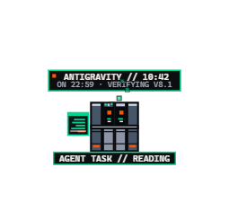
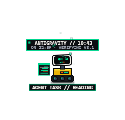
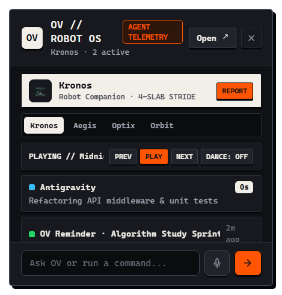
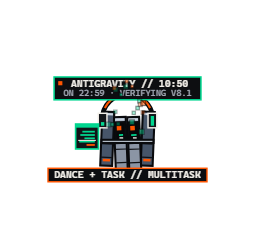

<div align="center">
  <picture>
    <source media="(prefers-color-scheme: dark)" srcset="docs/assets/ov-mark-white-transparent.png" />
    <source media="(prefers-color-scheme: light)" srcset="docs/assets/ov-mark-black-transparent.png" />
    
  </picture>
  <h1>OV v8.1 — JARVIS Voice OS &amp; Robot Companion</h1>
  <p><strong>A local-first JARVIS voice operating system, AI robot companion &amp; live coding-agent monitor for Windows.</strong></p>
  <p>
    <a href="LICENSE"></a>
    
    
    
    
  </p>
  <p>Unified <code>A+S+D</code> Voice Execution · Open IDE Projects + Dispatch AI Prompts · Direct YouTube Auto-Play · Safe Folder &amp; Recycle-Bin Ops · 4 Industrial Robots · 7 Consistent Named Voices (EN / Hinglish / Hindi)</p>
</div>

<p align="center">
  
</p>

> **Compatibility & IP Separation Notice:** **OV v8.0** (`ov-desktop-companion`) is a local-first desktop robot companion ecosystem featuring four original industrial robot units (**Kronos** — Interstellar 4-Slab Articulated Monolith, **Aegis** — Bipedal Field Mech, **Optix** — Deep Research Rover, and **Orbit** — Autonomous Synth Pod), a **Companion Studio** for custom user robots, and an **Age-Based Persona System**. This repository contains only original procedural vector/canvas hardware artwork, zero-gradient industrial UI templates, and synthesized Web Audio motifs — **zero** copyrighted third-party bitmaps, movie stills, trademarked logos, or soundtrack files are included. All user-uploaded artwork and custom robot packs remain strictly local on your device (`%LOCALAPPDATA%\PetFish\custom-heroes\`). Review [`docs/PRE_RELEASE_CHECKLIST.md`](docs/PRE_RELEASE_CHECKLIST.md) before public distribution.

---

## What You Can Do Right After Downloading OV v8.0

Even with **zero coding or AI setup**, downloading OV gives you an always-on-top desktop robot that acts as your personal voice assistant, media controller, focus timer, and live coding-agent monitor:

- **JARVIS Voice Control Anywhere (`A + S + D`):** Hold **`A + S + D`** together anywhere on Windows and speak naturally in **English, Hinglish, or Hindi**:
  - *"Hey bro go to Antigravity and open free window radar and tell him to update the navbar in the website"* — launches Antigravity on your matching project folder, focuses AI chat, and sends the instruction automatically!
  - *"Go on YT and play Kesariya song"* — resolves the real YouTube track and starts playing automatically with `&autoplay=1`!
  - *"Make a website folder called portfolio on desktop"* — creates the folder, scaffolds starter `index.html` / `styles.css` / `script.js`, and opens it!
  - *"Delete portfolio from desktop"* — safely moves files/folders to the **Windows Recycle Bin** while strictly blocking `C:\Windows`, `Program Files`, and user root paths.
  - *"Download VLC"* or *"Download https://..."* — installs software via `winget` or saves HTTPS files cleanly into Downloads.
  - *"Create a demo folder and then play lo-fi beats on YouTube"* — chains multi-step actions sequentially!
- **Pick 1 of 4 Industrial Robots (16 Skins + Custom Studio):** Switch instantly between **Kronos** (Interstellar 4-Slab Monolith), **Aegis** (Bipedal Field Mech), **Optix** (Deep Research Rover), and **Orbit** (Autonomous Synth Pod) — or build your own in Companion Studio.
- **Live Top-of-Head Coding-Agent Timers:** When `Antigravity`, `Claude Code`, `Cursor`, or a Focus Timer runs, a live digital timer (`[ANTIGRAVITY // MM:SS · ON HH:MM]`) ticks right above your robot's head. Click **`REPORT`** to hear what it's doing, when it started, and how long it has been running.
- **Control Music & Toggle Dance Mode Anywhere:** Use `PREV / PLAY / NEXT` and `DANCE: ON/OFF` right inside the compact **Mini Popover** or **Control Center**. When Dance Mode is ON and music plays, your robot puts on wireframe **Studio Headphones** with animated EQ bars; when an agent works simultaneously, it enters **`DANCE + TASK // MULTITASK`** mode.
- **Single Consistent Named Voice (EN / Hinglish / Hindi):** Pick one of 7 human neural voices (**Arjun**, **Kavya**, **Kabir**, **Meera**, **Andrew**, **Ava**, **Brian**) and OV sticks 100% with that exact voice across every reply.
- **Optional Local LLM & Android Phone Remote:** Connect **Ollama** or **LM Studio** for unrestricted local AI chat & clipboard code explanation, or build and pair the **Android Remote APK** over Wi-Fi / HTTPS with a 6-digit PIN.

---

## Original OV Robot Units (4 Core Robots · 16 Skins · Companion Studio)

| Kronos — Interstellar 4-Slab Monolith | Aegis — Bipedal Field Mech | Optix — Deep Research Rover | Orbit — Autonomous Synth Pod |
| :---: | :---: | :---: | :---: |
|  |  |  |  |
| 4 articulated titanium slabs, OLED visor & waveform mouth | Bipedal servo legs, rotary chest dial & OLED face | Caterpillar treads, articulated neck & capsule optics | Zero-G magnetic levitation & curved OLED shield |

---

## Hardware Interface Preview (Zero-Gradient Robot OS)

| Mini Popover (Music Controls + Dance Toggle) | Multitask Mode (Headphones + Live Agent Timer) |
| :---: | :---: |
|  |  |

| Whisper Voice & AI Chat (`COPY / SPEAK / DEL`) | Live AI Coding-Agent Monitor (`START HH:MM / REPORT`) |
| :---: | :---: |
|  |  |

| Control Center & Music Player | Studio & Robot Customizer |
| :---: | :---: |
|  |  |

---

## System Architecture

<p align="center">
  
</p>

---

## Complete Step-by-Step Download & Setup Guide (Beginner-Friendly)

### Prerequisites (Free, Official Downloads)
1. **Windows 10 or Windows 11**
2. **Node.js 20+ (LTS)** — download from [nodejs.org](https://nodejs.org/)
3. **Python 3.10–3.13** *(for the Local Whisper Voice Pack & 7 Neural Voices)* — download from [python.org/downloads/windows](https://www.python.org/downloads/windows/) *(check **"Add python.exe to PATH"** during setup)*
4. **Optional (Local AI Brain):** [Ollama](https://ollama.com) or [LM Studio](https://lmstudio.ai)

---

### Step 1 — Download & Launch OV Desktop

Open **PowerShell** (or Windows Terminal) and run:

```powershell
# 1. Clone the repository (or click Code -> Download ZIP on GitHub and extract it)
git clone https://github.com/ASKCODER15/ov-desktop-companion.git
cd ov-desktop-companion

# 2. Install Electron (zero external runtime npm dependencies)
npm install

# 3. Launch OV v8.0 Desktop
npm start
```

*(Optional)* Create a desktop shortcut (`OV.lnk`) so you can launch OV with a double-click:
```powershell
npm run shortcut
```

---

### Step 2 — Install the Local Whisper Voice Pack (`A + S + W` + 7 Named Voices)

Run our **1-click voice pack installer**:

```powershell
npm run setup:voice
```

**What `npm run setup:voice` automatically does for you:**
1. Finds Python 3.10+ on your Windows PC.
2. Installs `faster-whisper`, `pyaudio`, `numpy`, and `edge-tts` from [`requirements-voice.txt`](requirements-voice.txt).
3. Pre-downloads the open-source **`Systran/faster-whisper-base`** offline speech recognition model (`~145 MB`) into your local Hugging Face cache and checks your microphone.

**Now press `A + S + D` together anywhere on Windows** (or click **`JARVIS MIC`** in the Chat tab) and speak in **English, Hinglish, or Hindi**!
- *Note:* If you skip Step 2, OV still runs cleanly and falls back to Windows built-in speech recognition.

---

### Step 3 (Optional) — Connect a Local LLM (Ollama / LM Studio)

Even **without** Ollama, OV's JARVIS Voice Agent (`A+S+D`) and Built-In Task Brain work immediately for launching Antigravity/IDE projects, playing YouTube tracks, creating/recycling folders, installing apps, and monitoring coding agents.

To unlock deep AI coding, math, and **Focus Lens** clipboard explanation locally:
1. Install [Ollama](https://ollama.com) (`127.0.0.1:11434`) or [LM Studio](https://lmstudio.ai) (`127.0.0.1:1234`).
2. Pull a fast model:
   ```powershell
   ollama run qwen2.5:3b
   ```
3. Open **OV → Chat** (or press **`A + S + D`**). OV auto-detects your model automatically.

---

### Step 4 (Optional) — Build & Pair the Android Remote Companion

1. Run `npm run build:apk` to compile and v2-sign `mobile/PetFish-Mobile.apk` (`~76.5 KB`).
2. Install the APK on your Android phone (or open the pairing URL in any mobile browser).
3. In OV Desktop, open **Studio → Mobile Remote & Security → LAN Wi-Fi** (or **Start HTTPS**), scan the offline QR code, and enter the 6-digit pairing PIN.

---

## Feature Summary Table

| Capability | What OV v8.0 Provides |
|---|---|
| **4 Industrial Desktop Robots** | Always-on-top `204 × 196` transparent HTML5 Canvas robot (**Kronos**, **Aegis**, **Optix**, **Orbit**) with 16 hardware skins, recessed OLED face screens, animated speaking mouths, and elastic drag physics. |
| **Zero-Gradient Hardware UI** | 100% solid matte carbon (`#101114`) + warm archival paper (`#f2efe9`) interface with sharp `2px`/`4px` industrial corners, crisp monospace typography, tactile mechanical clicks, Mini Popover music controls + **`DANCE: ON/OFF`** toggle, and zero scrollbar slider clutter. |
| **JARVIS Voice OS (`A+S+D`)** | Press **`A + S + D`** anywhere on Windows for offline **`faster-whisper`** speech-to-text + autonomous multi-step execution (IDE projects + prompts, direct YouTube playback, folders, Recycle-Bin delete, downloads, volume, screenshots). Speaks back with one consistent named voice (**Arjun**, **Kavya**, **Kabir**, **Meera**, **Andrew**, **Ava**, **Brian**). |
| **Live Agent Head Timer & Telemetry** | Real-time top-of-head digital timer (`[ANTIGRAVITY // MM:SS]`), automatic & on-demand voice announcements, corner speech readout with **`COPY`**, Claude Code hook bridge (`PermissionRequest`, `Notification`, `Stop`), and 1-click **Allow / Deny**. |
| **Age-Based Personas (`1–14`, `15–29`, `30–60`)** | 12 Robot × Age combinations that adjust robot speed, optics, and spoken persona. |
| **Security-First Local Architecture** | Sandboxed Electron (`contextIsolation: true`, `nodeIntegration: false`, `sandbox: true`), loopback-only hook server (`127.0.0.1:47821`) with 256-bit constant-time token auth, `icacls` user-only file ACLs, zero telemetry, and opt-in Mobile Remote. |

---

## Development & Verification Commands

```powershell
npm start            # Launch OV v8.0 Desktop via Electron
npm run setup:voice  # 1-click install for Local Whisper (faster-whisper) & 7 Neural Voices
npm run verify       # Run the 8-stage security, Whisper/voice, robot physics & mobile test suite
npm run shortcut     # Create Desktop OV.lnk shortcut
npm run build:apk    # Compile & v2-sign Android APK (mobile/PetFish-Mobile.apk)
```

---

## Security & Privacy Notes

Please review [`SECURITY.md`](SECURITY.md) for complete details on renderer sandboxing, loopback token authentication (`127.0.0.1:47821`), opt-in mobile PIN/Bearer security (`:47822`), indirect prompt-injection blocking on `Focus Lens`, and local data isolation in `%LOCALAPPDATA%\PetFish\`.

## License

Provided under the [MIT License](LICENSE). See [`docs/PRE_RELEASE_CHECKLIST.md`](docs/PRE_RELEASE_CHECKLIST.md) and [`THIRD_PARTY_NOTICES.md`](THIRD_PARTY_NOTICES.md) for pre-release verification items.
