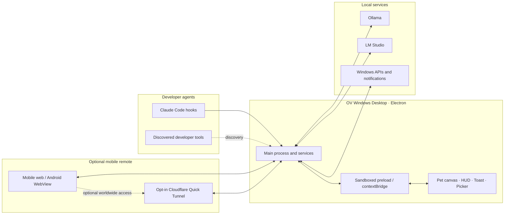

# OV v8.0 Architecture

This page summarises the architecture of **OV v8.0 (`OV // ROBOT OS`)** — a local-first Windows AI robot companion with offline Whisper (`faster-whisper`) voice control, 7 consistent named neural voices, live coding-agent timers, and an optional Android remote.

## Overview

## Main process

The Electron main process owns app lifecycle, desktop windows, IPC handlers, physics updates, background monitoring, local AI orchestration, Windows controls, notification reading, the hook server, and the mobile remote server.

## Renderer windows

The renderer architecture separates the floating robot canvas (`fish-window.html`), zero-gradient hardware HUD (`hud.html`), notification/approval toast (`toast.html`), and click-to-move spot picker. Every window enforces `contextIsolation: true`, `nodeIntegration: false`, `sandbox: true`, `webSecurity: true`, `allowRunningInsecureContent: false`, navigation blocking, and denied new-window handling.

## Local Whisper Voice & Local AI

- **Local Open-Source Whisper (`src/services/neuralVoice.js`):** Holding **`A + S + W`** anywhere on Windows captures microphone audio via `pyaudio` with RMS silence-VAD and transcribes offline using `faster-whisper` (`Systran/faster-whisper-base` cached locally, with Windows `System.Speech.Recognition` fallback). Replies use a single user-selected named neural voice (`Arjun`, `Kavya`, `Kabir`, `Meera`, `Andrew`, `Ava`, `Brian`) in English, Hinglish, or Hindi.
- **Local LLM (`src/services/llmBrain.js`):** Auto-discovers Ollama (`127.0.0.1:11434`) and LM Studio (`127.0.0.1:1234`) over loopback HTTP, supports Fast/Think modes, per-message deletion, and works out-of-the-box with the built-in offline Task Brain even when no local LLM is running.

## Agent bridge

Claude Code hooks send permission and lifecycle events to the desktop's local hook server. Pending permission requests can be shown in the desktop UI and paired mobile UI. Auto-Pilot includes allow/deny rules, but pattern-based rules should not be treated as a complete security boundary.

## Mobile bridge

The mobile web UI is bundled for browser/WebView use. Pairing uses a short-lived PIN to exchange for a bearer token. A local LAN mode is available, and worldwide mode can start a Cloudflare Quick Tunnel after explicit user action. Task changes can queue locally while the desktop is offline and sync after reconnection.

## 4-Robot Ecosystem, Physics Engine & Age Personas

- **Data-Driven Robot Registry (`src/services/heroRegistry.js`):** Defines 4 original industrial robot units (**Kronos** — Interstellar 4-Slab Articulated Monolith, **Aegis** — Bipedal Field Mech, **Optix** — Deep Research Rover, **Orbit** — Autonomous Synth Pod — 16 skins total), 3 age-based persona profiles (`1–14 Young Explorers`, `15–29 Engineers & Builders`, `30–60 Architects & Mentors`), the 12-cell **Robot × Age-Profile** AI synergy matrix, and lossless safe migration (`migrateSettingsSafe`) for legacy profiles.
- **Companion Studio & Local Store (`src/services/customHeroStore.js`):** Stores user-created custom robot units plus validated local raster artwork (`PNG`/`JPEG`/`WebP`, magic-byte verified, ≤ 380 KB, SVG/script blocked) strictly under `%LOCALAPPDATA%\PetFish\custom-heroes\heroes.json`. Supports full CRUD, duplicate, and schema-validated JSON import/export.
- **Robot Physics Engine (`src/services/petPhysics.js`):** Drives distinct desktop kinematics (`stride`, `scout`, `drone`, plus custom movement templates) with damped spring elastic drag squish, optional Dance Mode (`settings.danceModeEnabled`), and simultaneous Multitask Mode.
- **Zero-Gradient Hardware & Archival Paper Design System (`src/renderer/styles.css` & `mobile/web/index.html`):** 100% solid opaque matte carbon (`#101114`) and archival warm paper (`#f2efe9`) surfaces with zero glass/blur/gradients, sharp `2px`/`4px` hardware corners, hidden scrollbar sliders, tactile mechanical buttons, and synthesized WebAudio key click feedback.

## Data and trust boundaries

- Renderer-to-main communication passes through a controlled preload bridge.
- Local AI providers communicate over loopback.
- The Claude hook server is documented as loopback-only and token-protected.
- Mobile access is authenticated and worldwide tunnelling is opt-in.
- Local secrets and user state are described as being stored outside the repository.
- Clipboard capture, notification reading, app discovery, active-window context, and agent transcripts can include sensitive information; these data flows must be clearly disclosed to users.
