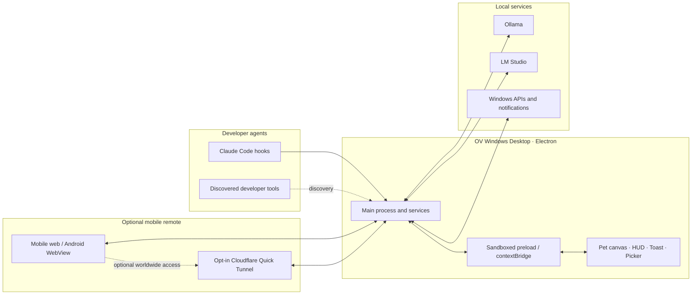

# OV Architecture

This page summarises the architecture described in the supplied OV v6.0 project report. Verify it against the exact source revision before using it as a formal security or engineering specification.

## Overview

## Main process

The Electron main process owns app lifecycle, desktop windows, IPC handlers, physics updates, background monitoring, local AI orchestration, Windows controls, notification reading, the hook server, and the mobile remote server.

## Renderer windows

The documented renderer architecture separates the floating companion canvas, living-glass HUD, notification/approval toast, and click-to-move spot picker. The report specifies context isolation, disabled Node integration, sandboxing, web security, navigation blocking, and denied new-window handling.

## Local AI

The local AI service discovers Ollama and LM Studio over loopback HTTP, filters embedding models, maintains a recent saved conversation, supports Fast/Think modes, and can interpret structured action tags emitted by the model. The model is local; optional browser/search integrations may still use external services when invoked.

## Agent bridge

Claude Code hooks send permission and lifecycle events to the desktop's local hook server. Pending permission requests can be shown in the desktop UI and paired mobile UI. Auto-Pilot includes allow/deny rules, but pattern-based rules should not be treated as a complete security boundary.

## Mobile bridge

The mobile web UI is bundled for browser/WebView use. Pairing uses a short-lived PIN to exchange for a bearer token. A local LAN mode is available, and worldwide mode can start a Cloudflare Quick Tunnel after explicit user action. Task changes can queue locally while the desktop is offline and sync after reconnection.

## Unified Companion & Robot Agent Ecosystem, 8-Archetype Physics & Age Personas

- **Data-Driven Unit Registry (`src/services/heroRegistry.js`):** Defines 7 original OV units across two distinct collections — **Heroes** (**Vesper**, **Vector**, **Umbra**, **Coral** — 20 skins) and **Robot Agents** (**Kronos** Heavy Task Monolith, **Optix** Deep Research Rover, **Orbit** Autonomous Synth Pod — 12 skins) — plus 8 movement archetypes (`swing`, `fly`, `glide`, `swim`, `float`, `stride`, `scout`, `drone`), 3 age-based persona profiles (`1–14 Young Heroes`, `15–29 Students & Builders`, `30–60 Mentors & Caretakers`), the 21-cell **Unit × Age-Profile** AI synergy matrix, and lossless safe migration (`migrateSettingsSafe`).
- **Companion Studio & Local Store (`src/services/customHeroStore.js`):** Stores user-created custom robot agents, heroes, and custom units plus validated local raster artwork (`PNG`/`JPEG`/`WebP`, magic-byte verified, ≤ 380 KB, SVG/script blocked) strictly under `%LOCALAPPDATA%\PetFish\custom-heroes\heroes.json`. Supports full CRUD, duplicate, and schema-validated JSON import/export.
- **8-Archetype Physics Engine (`src/services/petPhysics.js`):** Drives distinct desktop kinematics — hero archetypes (`swing`, `fly`, `glide`, `swim`, `float`) and specialized robot agent locomotion (`stride` for Kronos, `scout` for Optix, `drone` for Orbit) — all sharing damped spring elastic drag squish.
- **Solid Retro-Tech Paper & Matte Hardware Design System (`src/renderer/styles.css` & `mobile/web/index.html`):** 100% solid opaque matte carbon (`#131417`) and archival warm paper (`#f2efe9`) surfaces with zero glass/blur, mathematical 4px/8px grid geometry, poppy tactile mechanical buttons with `cubic-bezier(0.22, 1, 0.36, 1)` spring physics, and synthesized WebAudio mechanical key click feedback.

## Data and trust boundaries

- Renderer-to-main communication passes through a controlled preload bridge.
- Local AI providers communicate over loopback.
- The Claude hook server is documented as loopback-only and token-protected.
- Mobile access is authenticated and worldwide tunnelling is opt-in.
- Local secrets and user state are described as being stored outside the repository.
- Clipboard capture, notification reading, app discovery, active-window context, and agent transcripts can include sensitive information; these data flows must be clearly disclosed to users.
